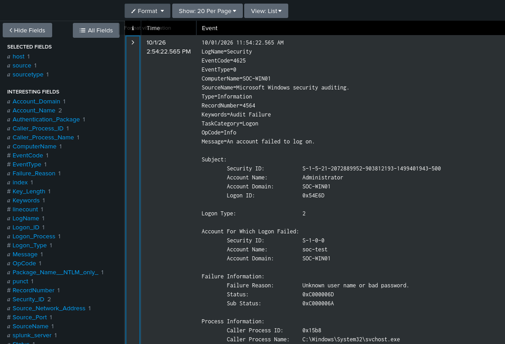
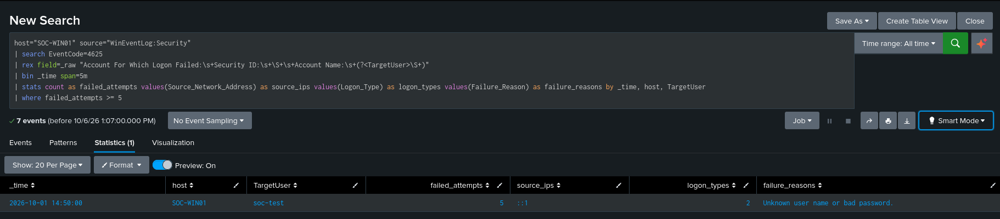
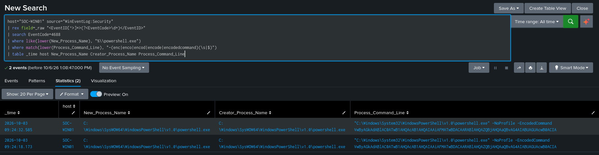
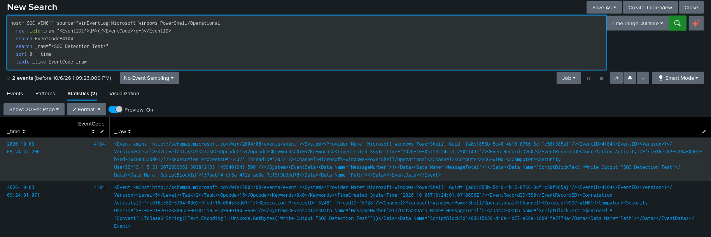
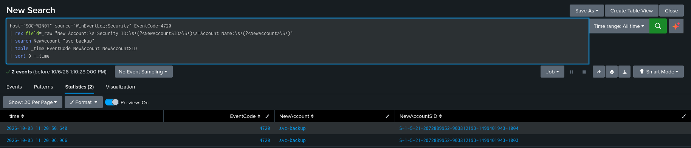
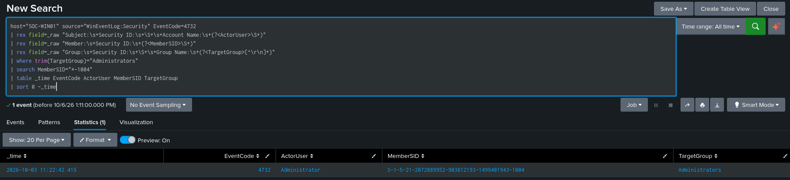
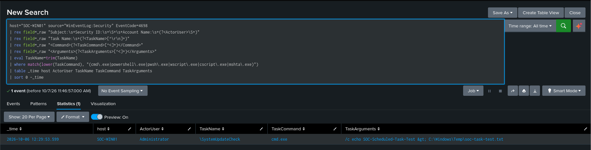
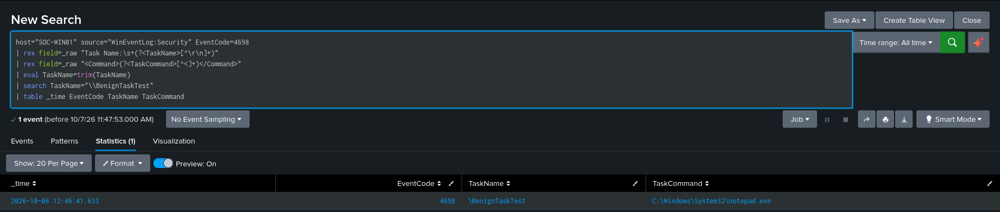
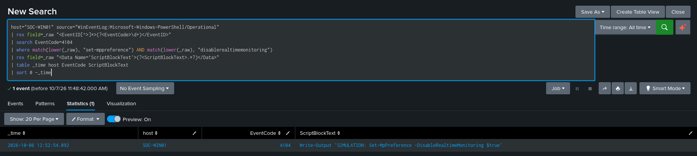
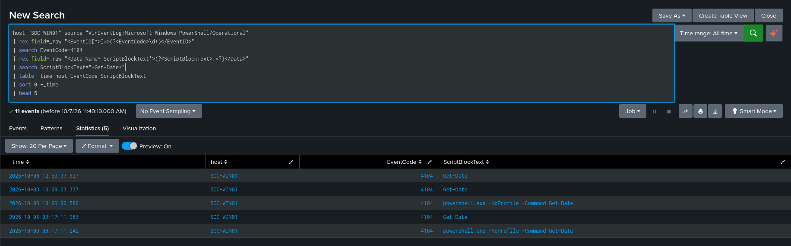

# Windows Detection Engineering with Splunk

A hands-on detection engineering lab focused on developing, testing, investigating, and tuning Windows security detections using Splunk.

The project simulates controlled suspicious activity on a Windows Server endpoint, collects Windows security telemetry using the Splunk Universal Forwarder, and analyzes the resulting events in Splunk Enterprise.

The goal is to demonstrate a practical SOC workflow:

**Generate Activity → Collect Telemetry → Detect → Investigate → Tune → Validate**

---

## Lab Architecture

```text
Windows Server 2022 — SOC-WIN01
│
├── Windows Security Event Log
├── PowerShell Operational Logging
└── Sysmon
        │
        │ Splunk Universal Forwarder
        ▼
Kali Linux
└── Splunk Enterprise
```

### Endpoint

- Windows Server 2022
- Hostname: `SOC-WIN01`
- Splunk Universal Forwarder
- Windows Advanced Audit Policy
- PowerShell Script Block Logging
- Sysmon

### SIEM

- Splunk Enterprise
- SPL-based detection development
- Windows event investigation
- Detection tuning and validation

---

## Detection Coverage

| # | Detection | Primary Event | MITRE ATT&CK |
|---|---|---|---|
| 001 | Repeated Failed Logons | Security 4625 | T1110 — Brute Force |
| 002 | Suspicious Encoded PowerShell | Security 4688 / PowerShell 4104 | T1059.001 — PowerShell |
| 003 | Local Administrator Group Modification | Security 4732 / 4720 | T1098 / T1136.001 |
| 004 | Suspicious Scheduled Task Creation | Security 4698 | T1053.005 — Scheduled Task |
| 005 | Windows Defender Security-Control Tampering | PowerShell 4104 | T1562.001 — Impair Defenses |

---

## Detection 001 — Repeated Failed Logons

### Scenario

Multiple failed interactive logons were generated against a controlled local account named `soc-test`.

Windows generated Event ID `4625` for the failed authentication attempts.

### Detection

The SPL detection:

- Extracts the target account from the raw Windows event
- Groups failed logons into five-minute windows
- Counts authentication failures
- Triggers when an account reaches five or more failures

Initial testing exposed a multivalue field issue where both the initiating and target account could appear in Splunk's `Account_Name` field.

The detection was tuned to explicitly extract the target account from the `Account For Which Logon Failed` section of the event.

### Result

The final detection identified:

- Target account: `soc-test`
- Failed attempts: `5`
- Logon type: `2`
- Source address: `::1`

The activity was generated intentionally in the lab and therefore does not by itself represent a real brute-force compromise.

[Detection Documentation](detections/001-failed-logons/detection.md)

[Detection SPL](detections/001-failed-logons/detection.spl)

### Evidence





---

## Detection 002 — Suspicious Encoded PowerShell

### Scenario

A controlled PowerShell command was Base64 encoded and executed using the `-EncodedCommand` parameter.

The command produced the harmless output:

```text
SOC Detection Test
```

### Detection

Windows Security Event ID `4688` captured the PowerShell process creation and encoded command line.

PowerShell Event ID `4104` provided additional investigation telemetry by exposing the decoded script block.

Sysmon Event ID `1` was also used during investigation to examine process context.

### Investigation

The investigation correlated:

```text
4688
  ↓
powershell.exe -EncodedCommand ...
  ↓
4104
  ↓
Write-Output "SOC Detection Test"
```

A normal PowerShell `Get-Date` execution was used as a control and did not trigger the encoded-command detection.

### Result

The detection successfully identified encoded PowerShell execution while normal PowerShell activity was excluded.

[Detection Documentation](detections/002-suspicious-powershell/detection.md)

[Detection SPL](detections/002-suspicious-powershell/detection.spl)

### Evidence





---

## Detection 003 — Local Administrator Group Modification

### Scenario

A controlled local account named:

```text
svc-backup
```

was created and subsequently added to the local `Administrators` group.

### Detection

The primary detection monitors:

- Event ID `4732` — Member added to a security-enabled local group

Event ID `4720` was used during investigation to identify the account creation.

The `4732` event did not provide the member account name directly, so the member SID was extracted and correlated with the account-creation event.

### Investigation

The resulting sequence was:

```text
4720
svc-backup created
SID ending -1004
        ↓
4732
same SID added to Administrators
        ↓
Actor: Administrator
```

This demonstrates how an analyst can correlate Windows events when a single event does not contain all required context.

### Result

The detection successfully identified modification of the local `Administrators` group and correlated the affected SID with the newly created `svc-backup` account.

[Detection Documentation](detections/003-account-manipulation/detection.md)

[Detection SPL](detections/003-account-manipulation/detection.spl)

### Evidence





---

## Detection 004 — Suspicious Scheduled Task Creation

### Scenario

A controlled scheduled task named:

```text
SystemUpdateCheck
```

was created with an action executing `cmd.exe`.

A second task named:

```text
BenignTaskTest
```

executing `notepad.exe` was created as a control.

### Detection

Event ID `4698` records scheduled-task creation and contains the task XML.

The detection extracts:

- Actor
- Task name
- Command
- Arguments

It then identifies tasks launching selected command or script interpreters such as:

- `cmd.exe`
- `powershell.exe`
- `pwsh.exe`
- `wscript.exe`
- `cscript.exe`
- `mshta.exe`

### Tuning

Alerting on every scheduled-task creation would generate unnecessary noise because Windows and legitimate software create scheduled tasks routinely.

The final detection therefore focuses on selected interpreters rather than all Event ID `4698` events.

The control task using `notepad.exe` generated a valid `4698` event but was excluded from the final detection.

### Result

```text
SystemUpdateCheck → cmd.exe → DETECTED

BenignTaskTest → notepad.exe → NOT DETECTED
```

[Detection Documentation](detections/004-scheduled-task/detection.md)

[Detection SPL](detections/004-scheduled-task/detection.spl)

### Evidence





---

## Detection 005 — Windows Defender Security-Control Tampering

### Scenario

A safe PowerShell simulation generated script-block telemetry containing the pattern:

```text
Set-MpPreference -DisableRealtimeMonitoring $true
```

The string was treated as text for the lab simulation.

**Microsoft Defender was not actually disabled.**

### Detection

PowerShell Script Block Logging Event ID `4104` was used to identify script blocks containing both:

- `Set-MpPreference`
- `DisableRealtimeMonitoring`

This represents a command pattern associated with attempts to modify Microsoft Defender protection settings.

### Control Test

Normal PowerShell activity using:

```powershell
Get-Date
```

was also logged through Event ID `4104`.

The normal activity did not satisfy the Defender-tampering detection condition.

### Result

The detection successfully identified the simulated suspicious Defender command pattern while excluding normal PowerShell activity.

The presence of suspicious command text should be treated as an investigation lead rather than proof that Defender was successfully disabled.

[Detection Documentation](detections/005-security-control-tampering/detection.md)

[Detection SPL](detections/005-security-control-tampering/detection.spl)

### Evidence





---

## Detection Engineering Workflow

Each detection followed the same general methodology:

1. Identify the behavior to detect.
2. Confirm the required Windows telemetry.
3. Generate controlled test activity.
4. Verify the event locally.
5. Confirm ingestion into Splunk.
6. Develop the initial SPL detection.
7. Investigate the resulting telemetry.
8. Identify false-positive conditions.
9. Tune the detection.
10. Run a control test.
11. Document the detection and supporting evidence.

This process emphasizes detection validation rather than simply writing SPL queries against pre-existing datasets.

---

## Skills Demonstrated

- Splunk Enterprise
- SPL
- Windows Security Event Logs
- Windows Advanced Audit Policy
- PowerShell Script Block Logging
- Sysmon
- Splunk Universal Forwarder
- Windows authentication analysis
- Process execution analysis
- Account and privilege-change investigation
- Scheduled-task analysis
- PowerShell investigation
- Detection engineering
- Detection tuning
- False-positive analysis
- Event correlation
- MITRE ATT&CK mapping
- SOC investigation workflow

---

## Key Takeaways

This project demonstrated that detection engineering involves more than writing a query.

Reliable detections require understanding:

- Whether the endpoint generates the required telemetry
- Whether that telemetry reaches the SIEM
- How Windows events are structured
- Which fields can be trusted
- How multiple events can be correlated
- What legitimate activity can resemble malicious behavior
- How detection logic can be tuned without losing useful visibility

Several detections required changes to Windows audit configuration before the necessary events were available, reinforcing the importance of validating telemetry before relying on a detection.

---

## Disclaimer

All activity in this repository was generated in an isolated lab environment for defensive cybersecurity training.

No malware was deployed and no unauthorized systems were targeted.
